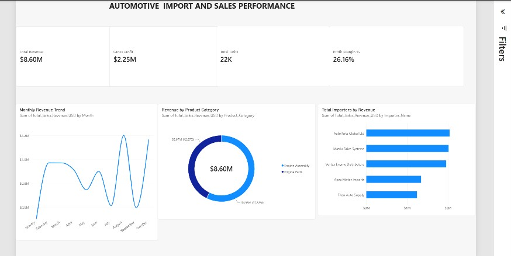

# Automotive Import & Sales Performance Analysis

## Project Overview
End-to-end data analytics project analyzing commercial automotive and spare parts importation, inventory volume, and dealer sales performance. Built to track revenue trends, gross profit margins, and top-performing importers across product categories.

## Executive Dashboard

## Key Performance Metrics
* **Total Revenue:** $8.60M
* **Gross Profit:** $2.25M
* **Total Units Sold:** 22K
* **Overall Profit Margin:** 26.16%

## Tools & Methodology
* **SQL (MySQL):** Data cleaning, aggregation, conditional categorization (`CASE` statements), and importer volume analysis (`02_parts_sales_analysis.sql`).
* **Power BI:** Data modeling, custom DAX measures (`Profit Margin %`), and interactive executive dashboard design (`automotive_import_sales.pbix`).
* **Excel:** Raw commercial shipment and sales dataset preparation.

## Key Business Insights
* **Revenue & Margin Health:** Maintained a strong **26.16%** gross profit margin across **$8.60M** in total sales revenue.
* **Seasonal Momentum:** Monthly sales revenue peaked in **August ($1.20M)** and **October ($1.17M)**, showing strong second-half commercial demand.
* **Category & Importer Concentration:** Identified core revenue drivers across Engine Assemblies and Engine Parts, alongside top-volume commercial importers.
*
